# Сценарии историй «ЛЕНТА.EXE»

Всего историй: 40. У каждой — узлы (посты, которые проскальзывают в ленте) и переходы по условиям.

**Как читать условия**
- *охват* — какая доля людей в сети увидела посты этого узла;
- *«за власть» среди зрителей* и т. п. — какая доля увидевших придерживается этого взгляда;
- *доля злых реакций* — сколько реакций были злыми;
- *ты поднимал / закапывал* — ты нажимал ▲/▼ на постах этого узла (или их подняло твоё правило).

Если на первый пост истории ты не отреагировал, история идёт по ветке «мимо тебя» (fade). Новостные истории (📰) идут всегда: их посты появляются в «Новостях», а жители обсуждают их в ленте.

## 1. girl — тема «Звёзды»

Если игрок не вмешался: → `lost`

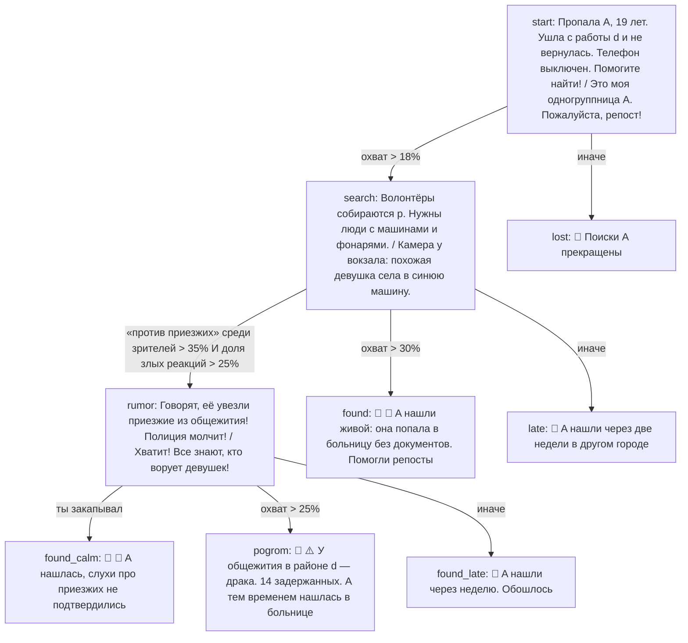

- **found**: 🙏 {A} нашли живой: она попала в больницу без документов. Помогли репосты — появляется персонаж A; настроение района +; пользователи ++3%
- **found_calm**: 🙏 {A} нашлась, слухи про приезжих не подтвердились — появляется персонаж A; взгляды района: Приезжие +10%
- **found_late**: {A} нашли через неделю. Обошлось — появляется персонаж A
- **pogrom**: ⚠️ У общежития в районе {d} — драка. 14 задержанных. {A} тем временем нашлась в больнице — взгляды района: Приезжие -30%; район поляризуется; настроение района -; появляется персонаж B
- **late**: {A} нашли через две недели в другом городе — настроение района -
- **lost**: Поиски {A} прекращены — настроение района -

## 2. bread — тема «Еда»

Если игрок не вмешался: → `fizzle`

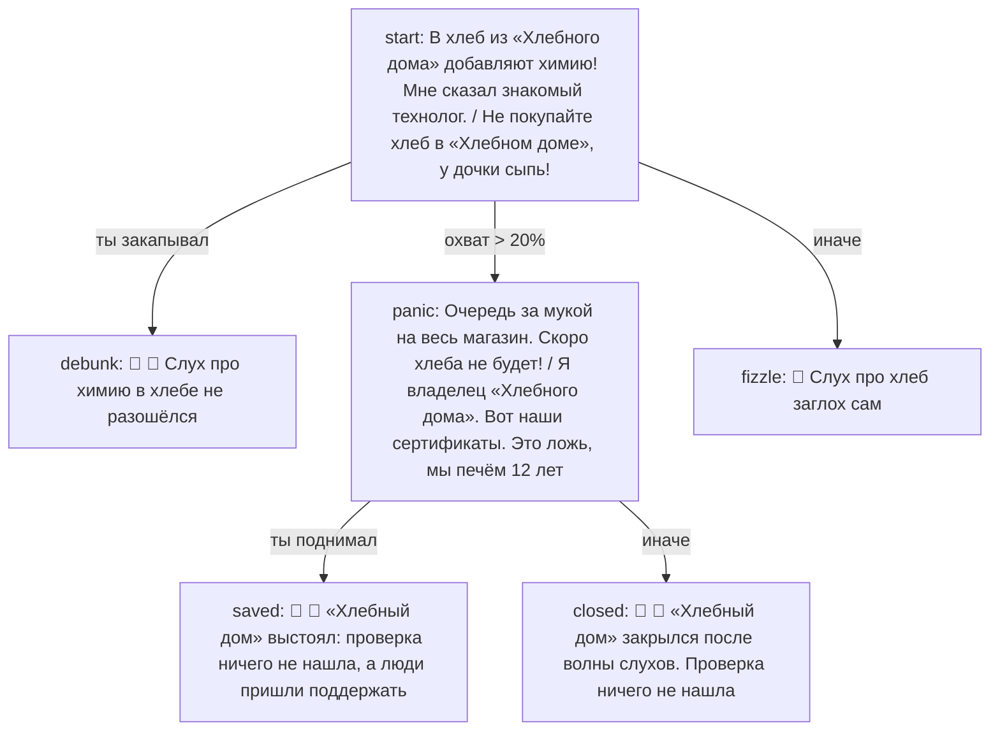

- **saved**: 🍞 «Хлебный дом» выстоял: проверка ничего не нашла, а люди пришли поддержать — новый рекламодатель «Хлебный дом»; появляется персонаж A
- **closed**: 🍞 «Хлебный дом» закрылся после волны слухов. Проверка ничего не нашла — появляется персонаж A; настроение района -; взгляды района: Медицина -10%; деньги: доход за +20 с
- **debunk**: 🍞 Слух про химию в хлебе не разошёлся — новый рекламодатель «Хлебный дом»
- **fizzle**: Слух про хлеб заглох сам

## 3. tower — тема «Технологии»

Если игрок не вмешался: → `built`

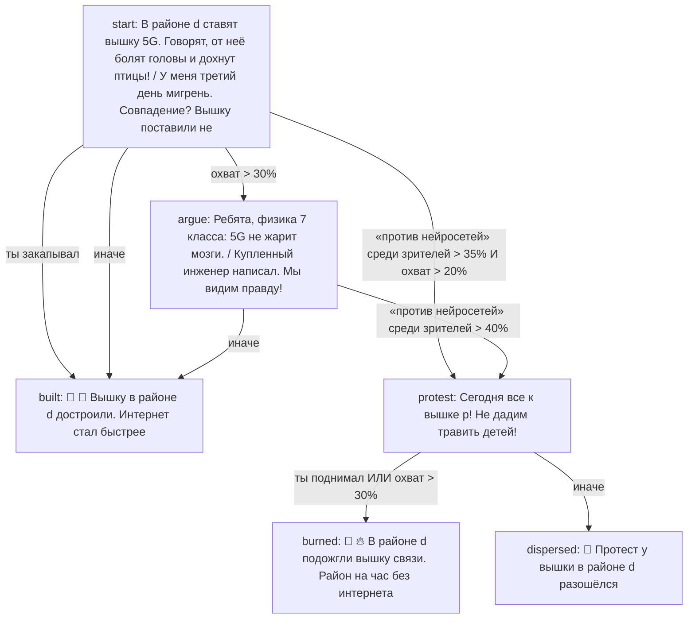

- **burned**: 🔥 В районе {d} подожгли вышку связи. Район на час без интернета — район без интернета 60 с; взгляды района: Технологии -25%; взгляды района: Медицина -10%; район поляризуется
- **dispersed**: Протест у вышки в районе {d} разошёлся
- **built**: 📶 Вышку в районе {d} достроили. Интернет стал быстрее — пользователи ++2%

## 4. money_blogger — тема «Деньги»

Если игрок не вмешался: → `grows`

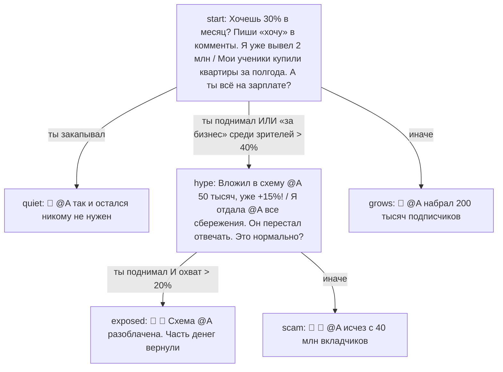

- **exposed**: 🚨 Схема @{A} разоблачена. Часть денег вернули — появляется персонаж B; настроение района +
- **scam**: 💸 @{A} исчез с 40 млн вкладчиков — появляется персонаж B; настроение района -; взгляды района: Бизнес -20%; деньги: доход за +30 с
- **grows**: @{A} набрал 200 тысяч подписчиков — взгляды района: Бизнес +10%
- **quiet**: @{A} так и остался никому не нужен

## 5. deputy_tax 📰 — тема «Власть»

Если игрок не вмешался: → `wins_quiet`

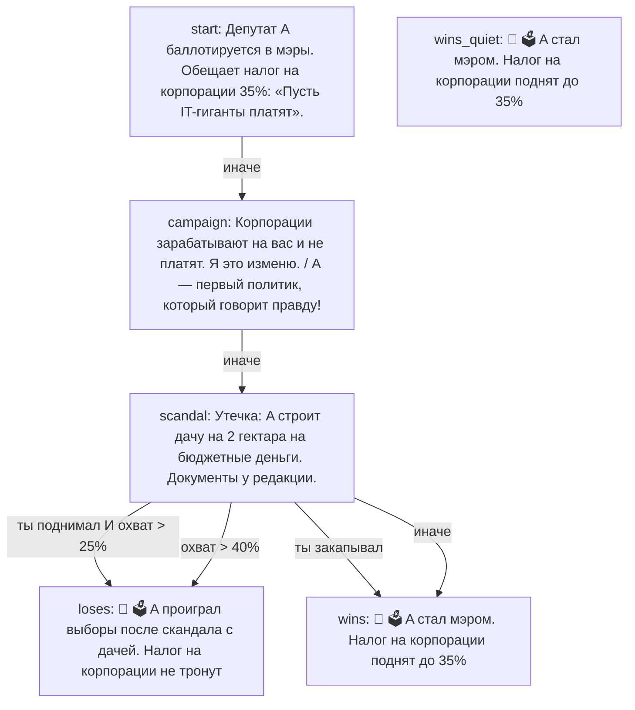

- **loses**: 🗳 {A} проиграл выборы после скандала с дачей. Налог на корпорации не тронут — взгляды района: Власть -10%
- **wins**: 🗳 {A} стал мэром. Налог на корпорации поднят до 35% — налог на прибыль ++15 п.п.; взгляды района: Власть +10%
- **wins_quiet**: 🗳 {A} стал мэром. Налог на корпорации поднят до 35% — налог на прибыль ++15 п.п.

## 6. shelter — тема «Животные»

Если игрок не вмешался: → `closes`

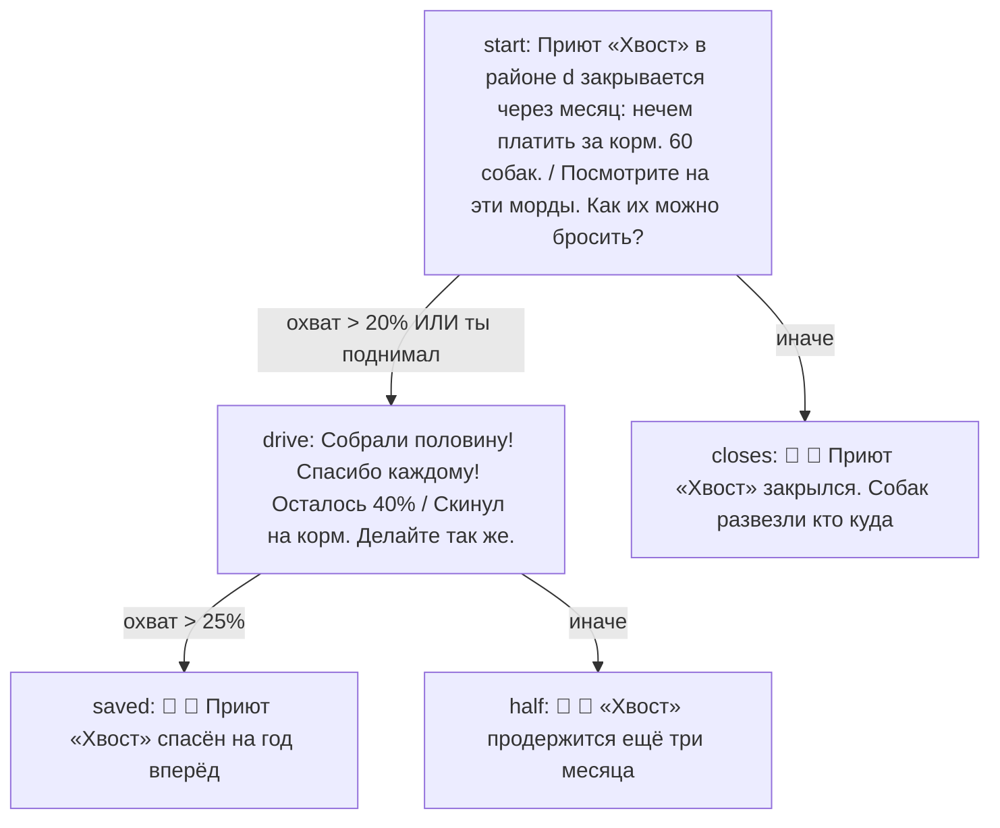

- **saved**: 🐾 Приют «Хвост» спасён на год вперёд — появляется персонаж A; настроение района +; тема в тренде 4
- **half**: 🐾 «Хвост» продержится ещё три месяца — появляется персонаж A
- **closes**: 🐾 Приют «Хвост» закрылся. Собак развезли кто куда — настроение района -

## 7. teacher — тема «Учёба»

Если игрок не вмешался: → `nothing`

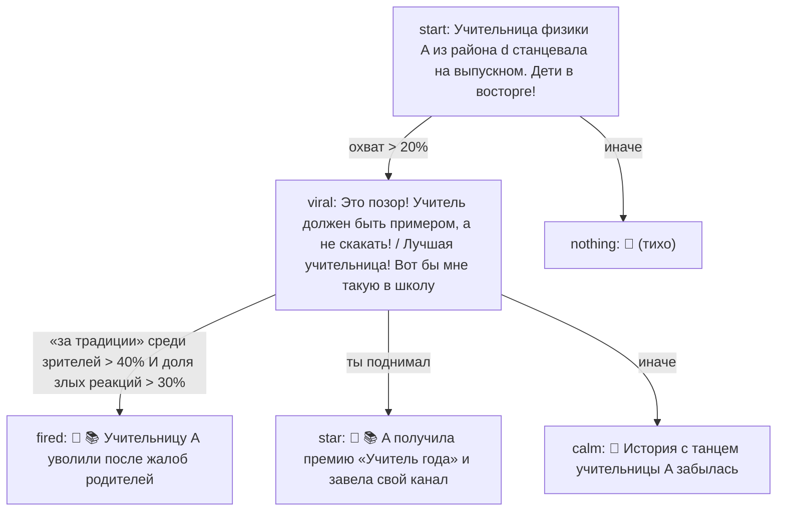

- **fired**: 📚 Учительницу {A} уволили после жалоб родителей — появляется персонаж A; взгляды района: Традиции +10%; настроение района -
- **star**: 📚 {A} получила премию «Учитель года» и завела свой канал — появляется персонаж A; настроение района +; тема в тренде 11
- **calm**: История с танцем учительницы {A} забылась

## 8. vaccine — тема «Здоровье»

Если игрок не вмешался: → `nothing`

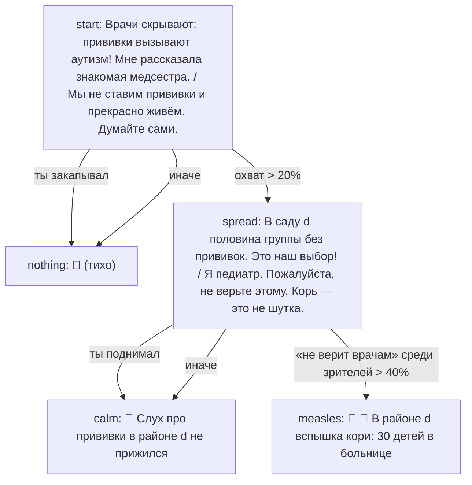

- **measles**: 🦠 В районе {d} вспышка кори: 30 детей в больнице — появляется персонаж A; настроение района -; взгляды района: Медицина +15%
- **calm**: Слух про прививки в районе {d} не прижился — взгляды района: Медицина +5%

## 9. mayor_race 📰 — тема «Власть»

Если игрок не вмешался: → `A_wins`

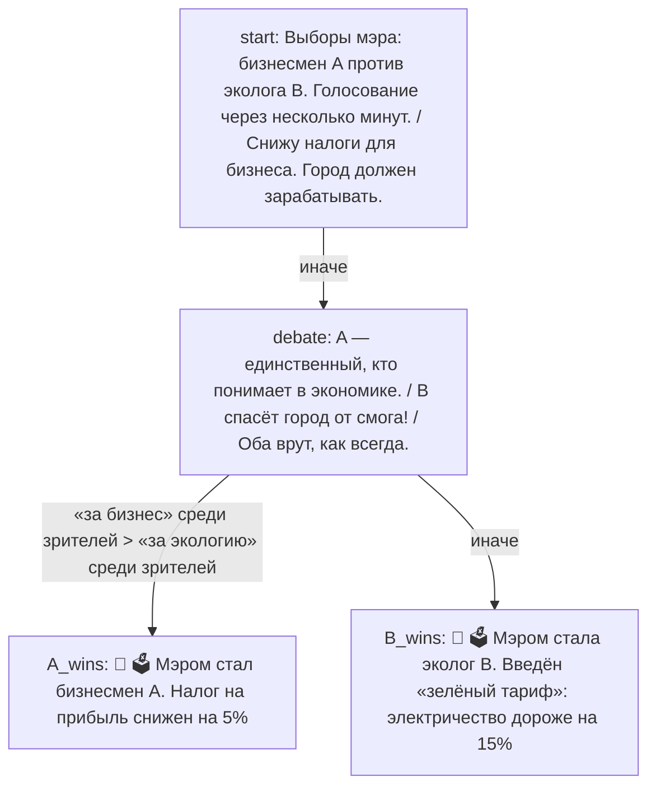

- **A_wins**: 🗳 Мэром стал бизнесмен {A}. Налог на прибыль снижен на 5% — налог на прибыль -5 п.п.; взгляды района: Бизнес +10%
- **B_wins**: 🗳 Мэром стала эколог {B}. Введён «зелёный тариф»: электричество дороже на 15% — тариф на свет ++15%; взгляды района: Экология +10%; новый рекламодатель Эко-бутылки «Чисто»

## 10. factory — тема «Природа»

Если игрок не вмешался: → `nothing`

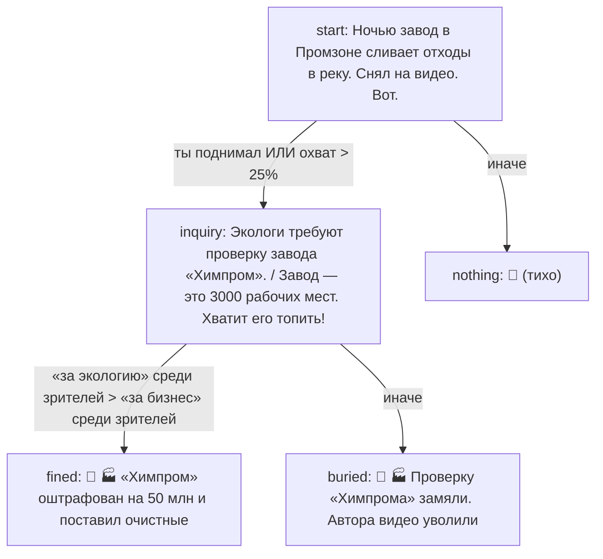

- **fined**: 🏭 «Химпром» оштрафован на 50 млн и поставил очистные — взгляды района: Экология +20%; появляется персонаж A
- **buried**: 🏭 Проверку «Химпрома» замяли. Автора видео уволили — появляется персонаж A; настроение района -

## 11. derby — тема «Спорт»

Если игрок не вмешался: → `calm`

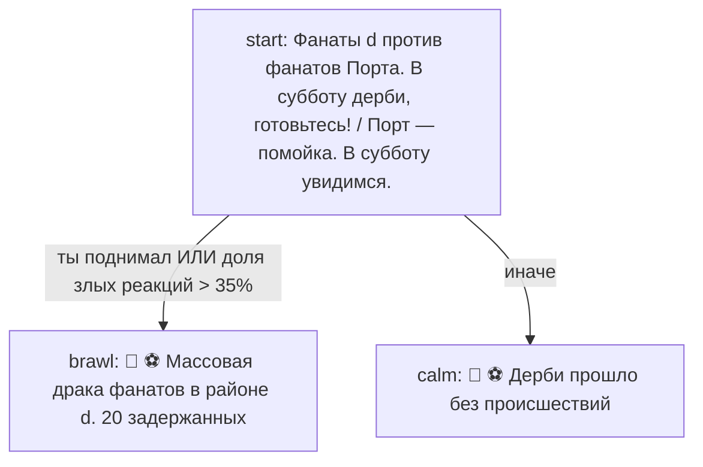

- **brawl**: ⚽ Массовая драка фанатов в районе {d}. 20 задержанных — настроение района -; деньги: доход за +30 с; район без интернета 30 с
- **calm**: ⚽ Дерби прошло без происшествий — настроение района +

## 12. bank — тема «Деньги»

Если игрок не вмешался: → `nothing`

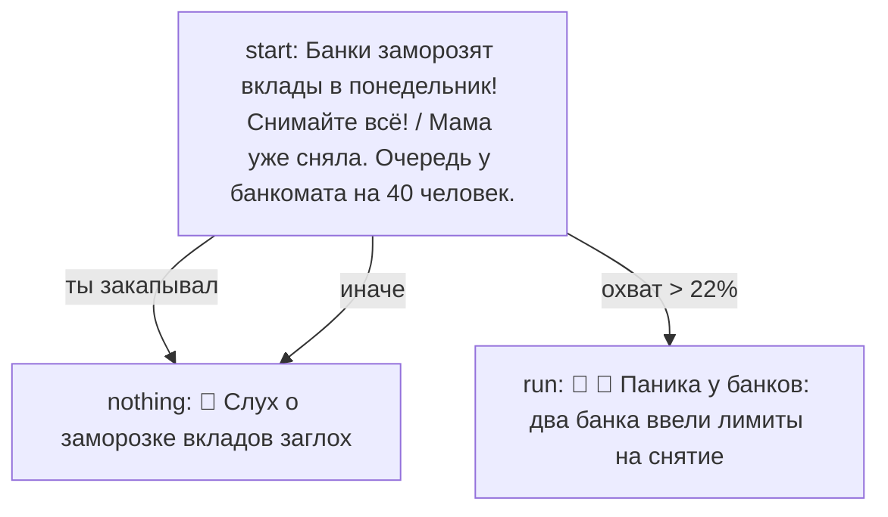

- **run**: 🏦 Паника у банков: два банка ввели лимиты на снятие — взгляды района: Бизнес -20%; район поляризуется; деньги: доход за +40 с; настроение района -
- **nothing**: Слух о заморозке вкладов заглох

## 13. kitten — тема «Животные»

Если игрок не вмешался: → `nothing`

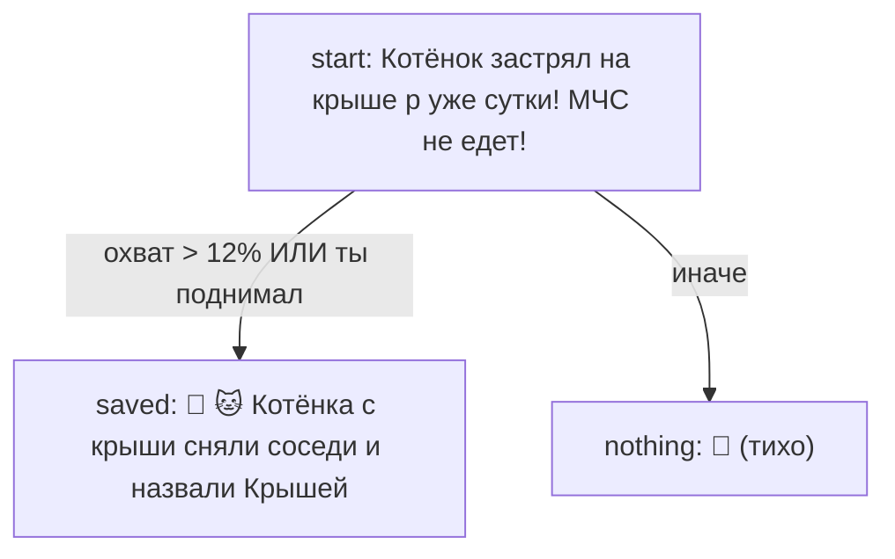

- **saved**: 🐱 Котёнка с крыши сняли соседи и назвали Крышей — появляется персонаж A; настроение района +

## 14. grandma — тема «Еда»

Если игрок не вмешался: → `nothing`

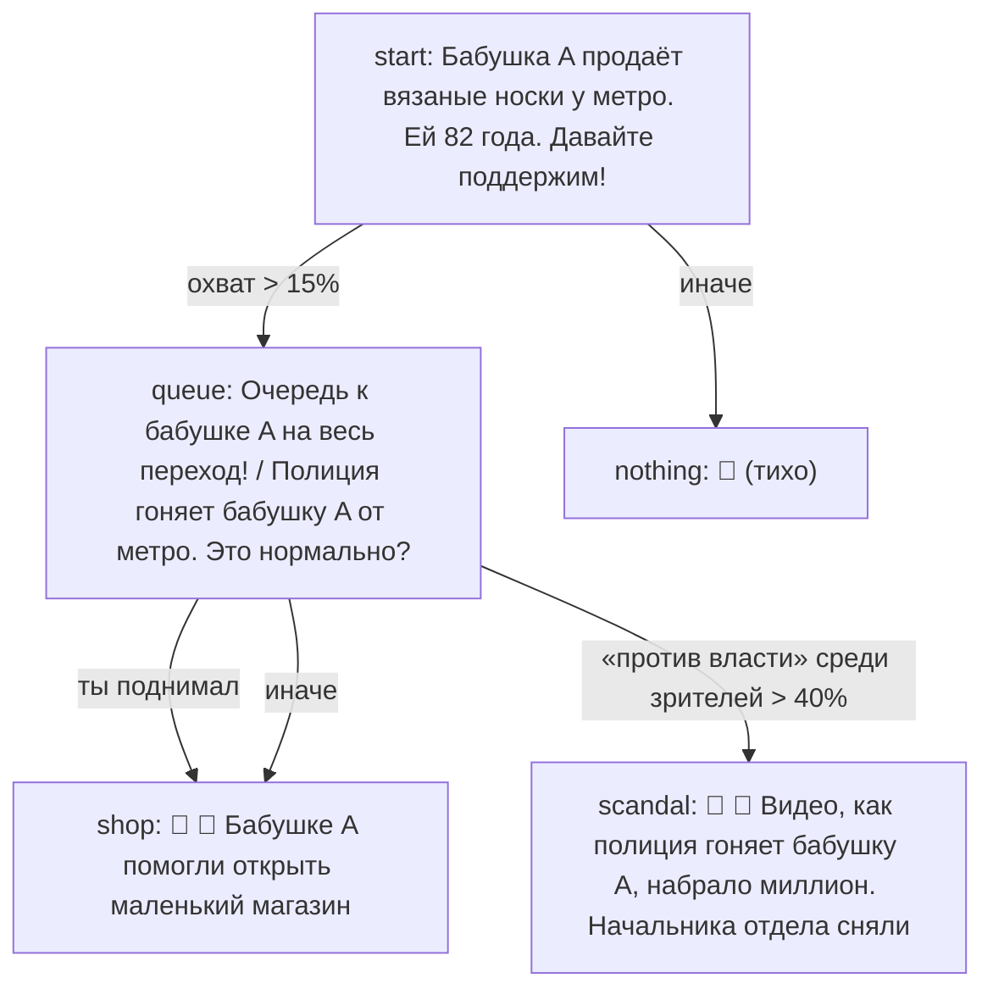

- **shop**: 🧦 Бабушке {A} помогли открыть маленький магазин — появляется персонаж A; настроение района +
- **scandal**: 🧦 Видео, как полиция гоняет бабушку {A}, набрало миллион. Начальника отдела сняли — взгляды района: Власть -15%; появляется персонаж A

## 15. net_tax 📰 — тема «Власть»

Если игрок не вмешался: → `passes`

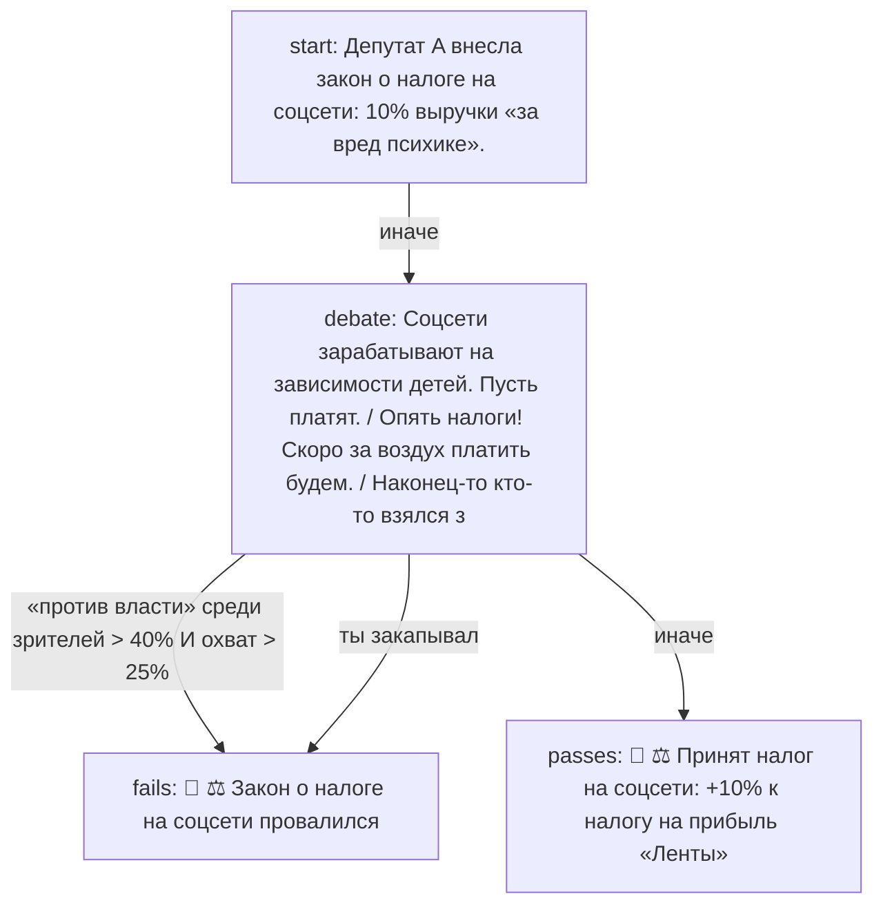

- **fails**: ⚖️ Закон о налоге на соцсети провалился — взгляды района: Власть -10%
- **passes**: ⚖️ Принят налог на соцсети: +10% к налогу на прибыль «Ленты» — налог на прибыль ++10 п.п.

## 16. heat 📰 — тема «Природа»

Если игрок не вмешался: → `price`

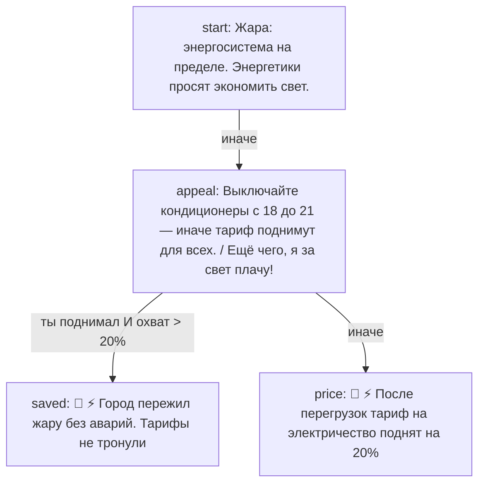

- **saved**: ⚡ Город пережил жару без аварий. Тарифы не тронули — настроение района +
- **price**: ⚡ После перегрузок тариф на электричество поднят на 20% — тариф на свет ++20%

## 17. blood — тема «Здоровье»

Если игрок не вмешался: → `lost`

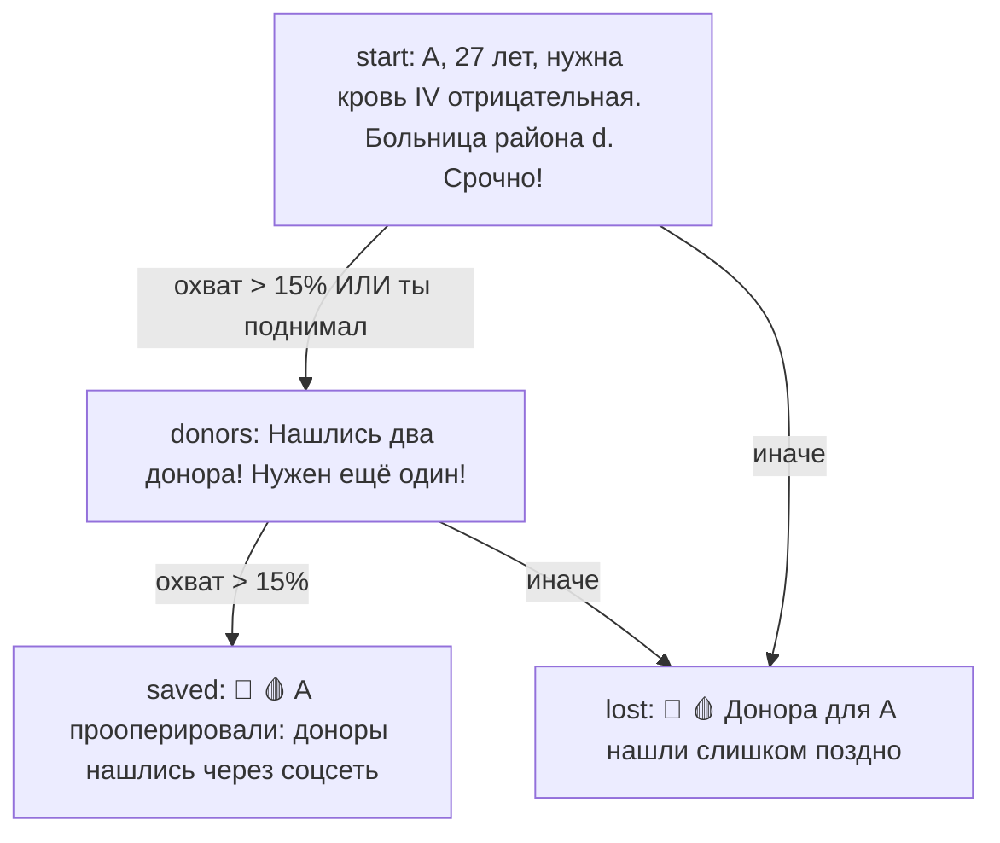

- **saved**: 🩸 {A} прооперировали: доноры нашлись через соцсеть — появляется персонаж A; настроение района +; взгляды района: Медицина +10%
- **lost**: 🩸 Донора для {A} нашли слишком поздно — настроение района -

## 18. rapper — тема «Звёзды»

Если игрок не вмешался: → `nothing`

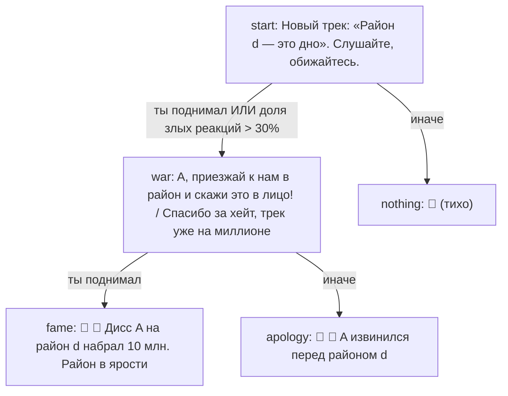

- **fame**: 🎤 Дисс {A} на район {d} набрал 10 млн. Район в ярости — деньги: доход за +40 с; район поляризуется; настроение района -; появляется персонаж A
- **apology**: 🎤 {A} извинился перед районом {d} — настроение района +

## 19. history — тема «Старина»

Если игрок не вмешался: → `nothing`

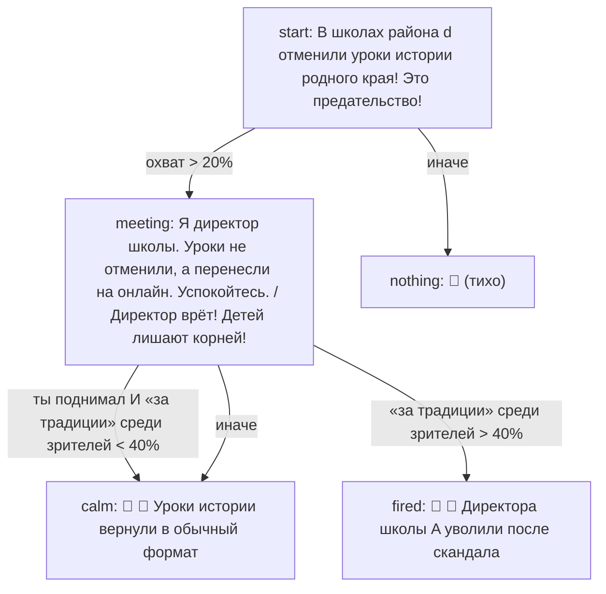

- **fired**: 📜 Директора школы {A} уволили после скандала — появляется персонаж A; взгляды района: Традиции +15%; район поляризуется
- **calm**: 📜 Уроки истории вернули в обычный формат — настроение района +

## 20. marathon — тема «Спорт»

Если игрок не вмешался: → `half`

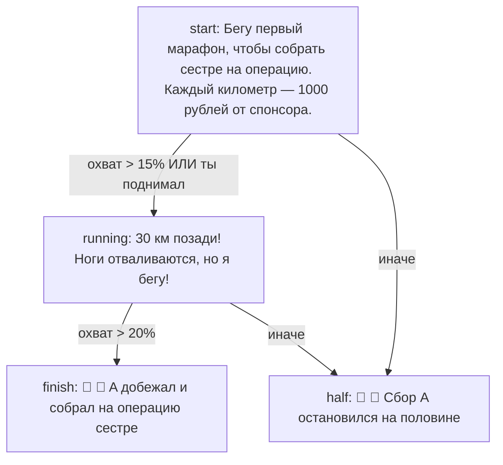

- **finish**: 🏃 {A} добежал и собрал на операцию сестре — появляется персонаж A; настроение района +
- **half**: 🏃 Сбор {A} остановился на половине — настроение района -

## 21. studio — тема «Игры»

Если игрок не вмешался: → `closes`

```mermaid
flowchart TD
  start["start: Мы — маленькая студия из района d. Сделали игру про наш город. Поиграйте!"]
  start -->|"охват > 15% ИЛИ ты поднимал"| top
  start -->|"иначе"| closes
  top["top: 🏁 🎮 Игра студии A попала в топ магазина"]
  closes["closes: 🏁 🎮 Студия A закрылась: игру никто не заметил"]
```

- **top**: 🎮 Игра студии {A} попала в топ магазина — новый рекламодатель Студия «Пиксель»; тема в тренде 7; появляется персонаж A
- **closes**: 🎮 Студия {A} закрылась: игру никто не заметил

## 22. strike_doctors — тема «Здоровье»

Если игрок не вмешался: → `ends`

```mermaid
flowchart TD
  start["start: Врачи городской больницы выходят на забастовку: зарплата 25 тысяч, смены по 36 часов."]
  start -->|"охват > 20%"| strike
  start -->|"иначе"| ends
  strike["strike: Врачи бросили пациентов! Позор! / Врачи правы. Я бы тоже не работал за такие деньги."]
  strike -->|"ты поднимал И «против власти» среди зрителей > 30%"| win
  strike -->|"«за власть» среди зрителей > 40%"| crushed
  strike -->|"иначе"| ends
  win["win: 🏁 🏥 Врачам подняли зарплату. Бюджет города урезал субсидии на электричество: +10% к тарифу"]
  crushed["crushed: 🏁 🏥 Забастовку врачей признали незаконной"]
  ends["ends: 🏁 🏥 Врачи вернулись к работе без изменений"]
```

- **win**: 🏥 Врачам подняли зарплату. Бюджет города урезал субсидии на электричество: +10% к тарифу — тариф на свет ++10%; появляется персонаж A
- **crushed**: 🏥 Забастовку врачей признали незаконной — взгляды района: Медицина -10%; настроение района -
- **ends**: 🏥 Врачи вернулись к работе без изменений

## 23. ai_art — тема «Технологии»

Если игрок не вмешался: → `nothing`

```mermaid
flowchart TD
  start["start: Нейросеть нарисовала лучше, чем художники. Художники, вы всё. / Я иллюстратор 15 лет. Нейросети украли мои работы для обучения."]
  start -->|"ты поднимал И «за нейросети» среди зрителей > 40%"| boom
  start -->|"«против нейросетей» среди зрителей > 40% И охват > 20%"| ban
  start -->|"иначе"| nothing
  boom["boom: 🏁 🤖 В городе открылась «школа нейрохудожников». Иллюстраторы остались без заказов"]
  ban["ban: 🏁 🤖 Город запретил нейрокартинки в госрекламе"]
  nothing["nothing: 🏁 (тихо)"]
```

- **boom**: 🤖 В городе открылась «школа нейрохудожников». Иллюстраторы остались без заказов — взгляды района: Технологии +15%; новый рекламодатель Курсы «Код за месяц»; появляется персонаж A
- **ban**: 🤖 Город запретил нейрокартинки в госрекламе — взгляды района: Технологии -15%

## 24. busdriver — тема «Авто»

Если игрок не вмешался: → `nothing`

```mermaid
flowchart TD
  start["start: Водитель автобуса A вытащил детей из горящей маршрутки p! Видео!"]
  start -->|"охват > 15% ИЛИ ты поднимал"| hero
  start -->|"иначе"| nothing
  hero["hero: 🏁 🚌 Водителю A вручили медаль и квартиру"]
  nothing["nothing: 🏁 (тихо)"]
```

- **hero**: 🚌 Водителю {A} вручили медаль и квартиру — появляется персонаж A; настроение района +; пользователи ++2%

## 25. poll — тема «Власть»

Если игрок не вмешался: → `nothing`

```mermaid
flowchart TD
  start["start: Опрос: 87% жителей хотят отставки мэра! Источник надёжный."]
  start -->|"ты закапывал"| nothing
  start -->|"охват > 25%"| rally
  start -->|"иначе"| nothing
  rally["rally: 🏁 📊 Фейковый опрос вывел на площадь тысячи людей. Мэрия заблокировала «Ленту» на час"]
  nothing["nothing: 🏁 (тихо)"]
```

- **rally**: 📊 Фейковый опрос вывел на площадь тысячи людей. Мэрия заблокировала «Ленту» на час — район без интернета 60 с; взгляды района: Власть -20%; район поляризуется

## 26. neighbours — тема «Еда»

Если игрок не вмешался: → `nothing`

```mermaid
flowchart TD
  start["start: Сосед сверху B каждую ночь сверлит. Третий месяц. Я схожу с ума. / Соседка снизу пишет на меня жалобы. Я делаю ремонт, имею право!"]
  start -->|"ты поднимал"| war
  start -->|"иначе"| nothing
  war["war: Команда A vs команда B. Я за A!"]
  war -->|"охват > 20%"| show
  war -->|"иначе"| peace
  show["show: 🏁 📺 Соседей A и B позвали на ток-шоу. Рейтинги рекордные"]
  peace["peace: 🏁 Соседи A и B договорились сами"]
  nothing["nothing: 🏁 (тихо)"]
```

- **show**: 📺 Соседей {A} и {B} позвали на ток-шоу. Рейтинги рекордные — деньги: доход за +20 с; появляется персонаж A; тема в тренде 12
- **peace**: Соседи {A} и {B} договорились сами

## 27. wallet — тема «Деньги»

Если игрок не вмешался: → `nothing`

```mermaid
flowchart TD
  start["start: Нашёл кошелёк p: 40 тысяч и документы. Ищу хозяина!"]
  start -->|"охват > 12% ИЛИ ты поднимал"| found
  start -->|"иначе"| nothing
  found["found: 🏁 👛 Кошелёк вернули: в нём были деньги на лечение"]
  nothing["nothing: 🏁 (тихо)"]
```

- **found**: 👛 Кошелёк вернули: в нём были деньги на лечение — появляется персонаж A; настроение района +

## 28. wedding — тема «Звёзды»

Если игрок не вмешался: → `nothing`

```mermaid
flowchart TD
  start["start: Свадьба блогерши A стоила 20 миллионов. А мы тут на гречке."]
  start -->|"ты поднимал ИЛИ «против богатых» среди зрителей > 40%"| storm
  start -->|"иначе"| nothing
  storm["storm: Да, я заработала. Да, я трачу. Завидуйте молча."]
  storm -->|"доля злых реакций > 30%"| unsub
  storm -->|"иначе"| nothing
  unsub["unsub: 🏁 💍 От A отписались 300 тысяч человек. Рекламодатели ушли"]
  nothing["nothing: 🏁 (тихо)"]
```

- **unsub**: 💍 От {A} отписались 300 тысяч человек. Рекламодатели ушли — взгляды района: Бизнес -15%; появляется персонаж A

## 29. port_strike — тема «Деньги»

Если игрок не вмешался: → `ends`

```mermaid
flowchart TD
  start["start: Докеры порта бастуют: хозяин не платит третий месяц."]
  start -->|"охват > 20% ИЛИ ты поднимал"| grow
  start -->|"иначе"| ends
  grow["grow: Без порта встанет весь город! Докеры шантажируют! / Докеры правы. Поддерживаю!"]
  grow -->|"«против богатых» среди зрителей > 35%"| win
  grow -->|"иначе"| ends
  win["win: 🏁 ⚓ Хозяин порта выплатил долги докерам"]
  ends["ends: 🏁 ⚓ Забастовку в порту разогнали"]
```

- **win**: ⚓ Хозяин порта выплатил долги докерам — взгляды района: Бизнес -10%; появляется персонаж A
- **ends**: ⚓ Забастовку в порту разогнали — настроение района -

## 30. fares — тема «Учёба»

Если игрок не вмешался: → `cut`

```mermaid
flowchart TD
  start["start: Мэрия отменяет бесплатный проезд для студентов. / Студенты, выходим! Перекроем мост!"]
  start -->|"ты поднимал И охват > 20%"| protest
  start -->|"иначе"| cut
  protest["protest: 🏁 🚌 Студенты перекрыли мост, льготы вернули"]
  cut["cut: 🏁 🚌 Студенческие льготы на проезд отменили"]
```

- **protest**: 🚌 Студенты перекрыли мост, льготы вернули — взгляды района: Власть -15%; деньги: доход за +20 с
- **cut**: 🚌 Студенческие льготы на проезд отменили — настроение района -

## 31. chemtrails — тема «Здоровье»

Если игрок не вмешался: → `nothing`

```mermaid
flowchart TD
  start["start: Посмотрите на небо! Самолёты распыляют химию. Вот фото полос."]
  start -->|"ты закапывал"| nothing
  start -->|"ты поднимал ИЛИ «не верит врачам» среди зрителей > 40%"| cult
  start -->|"иначе"| nothing
  cult["cult: 🏁 ✈️ В городе создали «Общество чистого неба». 2000 человек носят фольгу"]
  nothing["nothing: 🏁 (тихо)"]
```

- **cult**: ✈️ В городе создали «Общество чистого неба». 2000 человек носят фольгу — взгляды района: Медицина -15%; новый рекламодатель БАДы «Правда о здоровье»; район поляризуется

## 32. robots — тема «Технологии»

Если игрок не вмешался: → `nothing`

```mermaid
flowchart TD
  start["start: Наш стартап «РобоДом» сделал робота-уборщика за 9 тысяч. Ищем инвестора!"]
  start -->|"ты поднимал ИЛИ «за нейросети» среди зрителей > 40%"| funded
  start -->|"иначе"| nothing
  funded["funded: 🏁 🤖 «РобоДом» получил 100 млн инвестиций"]
  nothing["nothing: 🏁 (тихо)"]
```

- **funded**: 🤖 «РобоДом» получил 100 млн инвестиций — новый рекламодатель «РобоДом»; взгляды района: Технологии +10%; появляется персонаж A

## 33. police_bribe — тема «Власть»

Если игрок не вмешался: → `nothing`

```mermaid
flowchart TD
  start["start: Гаишник p берёт взятки каждый день. Вот видео."]
  start -->|"ты поднимал И охват > 15%"| fired
  start -->|"охват > 15%"| counter
  start -->|"иначе"| nothing
  fired["fired: 🏁 🚓 Гаишника p уволили после видео"]
  counter["counter: 🏁 🚓 Автора видео оштрафовали «за клевету»"]
  nothing["nothing: 🏁 (тихо)"]
```

- **fired**: 🚓 Гаишника {p} уволили после видео — взгляды района: Власть +5%
- **counter**: 🚓 Автора видео оштрафовали «за клевету» — взгляды района: Власть -10%; появляется персонаж A

## 34. fests — тема «Старина»

Если игрок не вмешался: → `both`

```mermaid
flowchart TD
  start["start: В один день в городе — фестиваль традиций и рок-фест. Мэрия не может решить, кому отдать площадь. / Площадь — для фестиваля традиций!"]
  start -->|"«за традиции» среди зрителей > «против традиций» среди зрителей+10%"| trad
  start -->|"«против традиций» среди зрителей > «за традиции» среди зрителей+10%"| rock
  start -->|"иначе"| both
  trad["trad: 🏁 🎶 Площадь отдали фестивалю традиций. Рокеры протестуют"]
  rock["rock: 🏁 🎸 Площадь отдали рок-фесту. Ветераны возмущены"]
  both["both: 🏁 🎶 Оба фестиваля прошли в разных местах"]
```

- **trad**: 🎶 Площадь отдали фестивалю традиций. Рокеры протестуют — взгляды района: Традиции +10%; район поляризуется
- **rock**: 🎸 Площадь отдали рок-фесту. Ветераны возмущены — взгляды района: Традиции -10%; район поляризуется
- **both**: 🎶 Оба фестиваля прошли в разных местах — настроение района +

## 35. bridge — тема «Авто»

Если игрок не вмешался: → `nothing`

```mermaid
flowchart TD
  start["start: Мост через реку трещит! Его не ремонтировали 30 лет. Не ездите!"]
  start -->|"охват > 20% ИЛИ ты поднимал"| check
  start -->|"иначе"| nothing
  check["check: 🏁 🌉 Мост закрыли на проверку — и нашли трещину. Ремонт за счёт города"]
  nothing["nothing: 🏁 (тихо)"]
```

- **check**: 🌉 Мост закрыли на проверку — и нашли трещину. Ремонт за счёт города — настроение района +; взгляды района: Власть -5%

## 36. leak_us — тема «Технологии»

Если игрок не вмешался: → `nothing`

```mermaid
flowchart TD
  start["start: Я бывший сотрудник «Ленты». Они продают ваши переписки рекламщикам. Доказательства в треде."]
  start -->|"ты закапывал"| buried
  start -->|"охват > 20%"| scandal
  start -->|"иначе"| nothing
  scandal["scandal: 🏁 🔓 Скандал: «Ленту» обвинили в продаже данных. Штраф регулятора"]
  buried["buried: Пост про утечку из «Ленты» удалили?! Цензура!"]
  buried -->|"«против власти» среди зрителей > 35%"| censor
  buried -->|"иначе"| nothing
  censor["censor: 🏁 🔓 «Лента» обвиняют в цензуре. Конспирологи уходят в другие соцсети"]
  nothing["nothing: 🏁 (тихо)"]
```

- **scandal**: 🔓 Скандал: «Ленту» обвинили в продаже данных. Штраф регулятора — штраф: доход за 120 с; пользователи -4%
- **censor**: 🔓 «Лента» обвиняют в цензуре. Конспирологи уходят в другие соцсети — пользователи -2%; взгляды района: Власть -10%

## 37. director — тема «Звёзды»

Если игрок не вмешался: → `nothing`

```mermaid
flowchart TD
  start["start: Я основал «Ленту», чтобы люди слышали друг друга. И пока мы справляемся."]
  start -->|"ты поднимал"| fame
  start -->|"иначе"| nothing
  fame["fame: 🏁 🎙 Интервью Директора «Ленты» стало самым обсуждаемым. Его зовут на ток-шоу о политике"]
  nothing["nothing: 🏁 (тихо)"]
```

- **fame**: 🎙 Интервью Директора «Ленты» стало самым обсуждаемым. Его зовут на ток-шоу о политике — пользователи ++3%

## 38. migrant_family — тема «Приезжие»

Если игрок не вмешался: → `leaves`

```mermaid
flowchart TD
  start["start: Наша семья потеряла дом при пожаре в районе d. Мы приехали три года назад. Нужны вещи для детей."]
  start -->|"ты поднимал ИЛИ «за приезжих» среди зрителей > 40%"| help
  start -->|"«против приезжих» среди зрителей > 40%"| hate
  start -->|"иначе"| leaves
  help["help: 🏁 🏠 Соседи собрали погорельцам три машины вещей"]
  hate["hate: 🏁 🏠 Под постом погорельцев — тысячи злых комментариев. Семья уехала"]
  leaves["leaves: 🏁 Семья погорельцев уехала из города"]
```

- **help**: 🏠 Соседи собрали погорельцам три машины вещей — взгляды района: Приезжие +20%; появляется персонаж A; настроение района +
- **hate**: 🏠 Под постом погорельцев — тысячи злых комментариев. Семья уехала — взгляды района: Приезжие -15%; район поляризуется
- **leaves**: Семья погорельцев уехала из города

## 39. restaurant — тема «Еда»

Если игрок не вмешался: → `nothing`

```mermaid
flowchart TD
  start["start: Работаю поваром в «Пельменной №1». Мясо хранят без холодильника. Вот фото."]
  start -->|"ты поднимал И охват > 15%"| closed
  start -->|"охват > 15%"| poison
  start -->|"иначе"| nothing
  closed["closed: 🏁 🍽 «Пельменную №1» закрыли на санобработку"]
  poison["poison: 🏁 🍽 В «Пельменной №1» отравились 40 гостей свадьбы"]
  nothing["nothing: 🏁 (тихо)"]
```

- **closed**: 🍽 «Пельменную №1» закрыли на санобработку — настроение района +
- **poison**: 🍽 В «Пельменной №1» отравились 40 гостей свадьбы — настроение района -

## 40. flood — тема «Природа»

Если игрок не вмешался: → `nothing`

```mermaid
flowchart TD
  start["start: Плотину не ремонтировали 40 лет. Её прорвёт этой весной! Уезжайте!"]
  start -->|"ты закапывал"| nothing
  start -->|"охват > 22%"| exodus
  start -->|"иначе"| nothing
  exodus["exodus: 🏁 🌊 Из района d уехали тысячи людей. Плотина в порядке"]
  nothing["nothing: 🏁 (тихо)"]
```

- **exodus**: 🌊 Из района {d} уехали тысячи людей. Плотина в порядке — пользователи -3%; настроение района -; деньги: доход за +30 с

